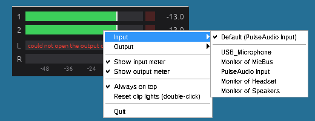

# gomic (Rust edition)

A small always-on-top stereo peak meter with latching clip lights, for Windows and macOS. This branch is a rewrite of the Go program in Rust.



**The full guide is [`README.html`](README.html)**: installation, usage, and a detailed comparison with the Go version. GitHub shows HTML files as source, so open it in a browser from a checkout.

## Install

You need [Rust](https://rustup.rs) 1.95 or newer. The equivalent of `go install` is:

```sh
cargo install --git https://github.com/mareklanduch/gomic --branch claude/rust-rewrite --locked
```

This builds `gomic` and puts it in `~/.cargo/bin` (`%USERPROFILE%\.cargo\bin` on Windows), which `rustup` adds to your `PATH`. No extra flags are needed on Windows: release builds never open a console window.

On macOS, build the app bundle instead, because macOS only grants audio access to a signed bundle:

```sh
git clone --branch claude/rust-rewrite https://github.com/mareklanduch/gomic
cd gomic
sh build_mac.sh
open gomic.app
```

## Using it

| Action | Result |
| --- | --- |
| Drag anywhere | Move the window |
| Double-click | Reset the clip lights |
| Right-click | Menu: input and output device submenus, show input meter, show output meter, always on top, reset, quit |

| Flag | Meaning |
| --- | --- |
| `--source input`, `--source output` or `--source both` | Show these meters, overriding the saved choice |
| `--probe 5s` | Print levels to the console for this long instead of opening the window |
| `--reset-position` | Forget the saved window position |
| `--help`, `--version` | The usual |

## Development

```sh
cargo fmt --check
cargo clippy --all-targets -- -D warnings
cargo test
cargo run --release
```

| Path | Contents |
| --- | --- |
| `src/main.rs` | Command line, startup, `--probe` |
| `src/app.rs` | The window: drawing, dragging, saved position |
| `src/menu.rs` | The right-click menu as data, shown natively through `muda` |
| `src/capture.rs` | Audio capture threads, through `cpal` |
| `src/meter.rs` | Peak scanning and bar rise/fall logic |
| `src/config.rs` | Saved settings |

## License

[MIT](LICENSE)
